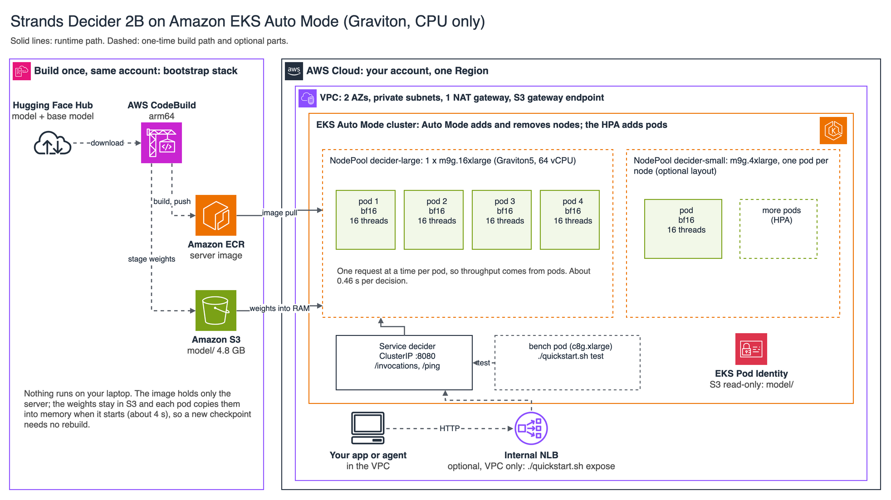
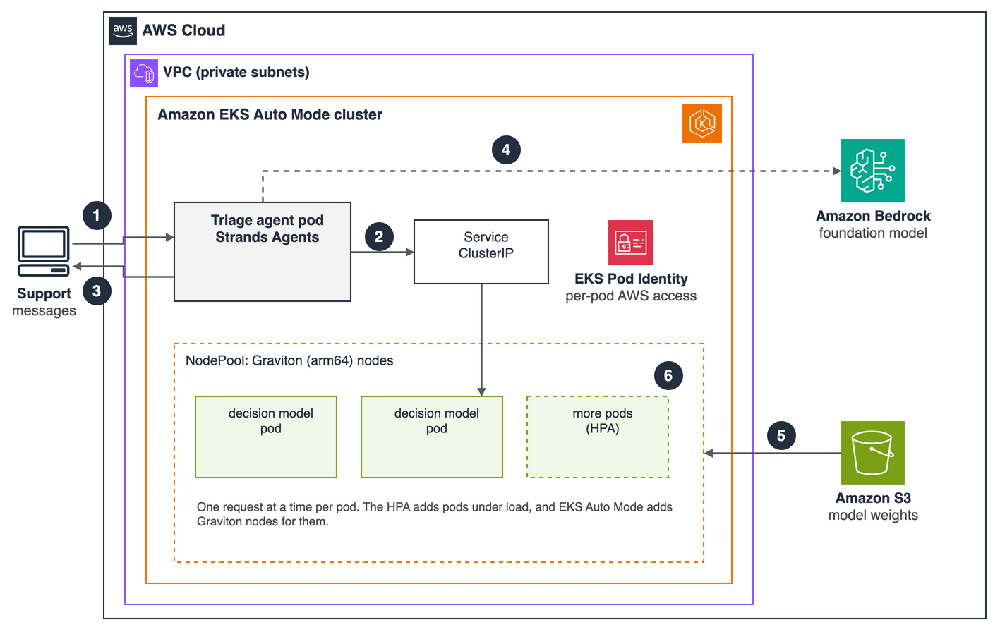

# Run decision models for AI agents on Amazon EKS Auto Mode

This sample deploys the open source [Strands Decider](https://github.com/strands-labs/strands-decider) decision
model on Amazon EKS Auto Mode with AWS Graviton nodes (CPU, no GPU) in your own AWS account, and adds a triage agent
built with Strands Agents that escalates low-confidence answers to Amazon Bedrock. One config file and one command
deploy it end to end and test it. It accompanies the AWS Containers Blog post of the same name.

This is sample code, for non-production usage. You should work with your security and legal teams to meet your
organizational security, regulatory and compliance requirements before deployment.



## Why EKS, and what to expect
Decision models such as Strands Decider answer an agent's bounded questions (route this request, is this
in scope, how urgent) in well under a second, without calling an LLM. On EKS you keep them inside your VPC,
next to the rest of your Kubernetes workloads, and scale them like any other service. Measured with this
quickstart (eu-west-1, 21 Oct 2026, `strands-decider-2B-qwen3.5-v1-2610`, the routing-100 test set):

| | |
|---|---|
| Accuracy | 0.81 route accuracy, in bf16 and fp32 (re-measured 25 Oct 2026 on the current test set) |
| Latency | **about 0.46 s per decision** (2 questions, about 250 input tokens; 4 pods x 16 threads on one m9g.16xlarge, bf16) |
| Throughput | about 5.3 decisions per second per m9g.16xlarge (8-16 in flight); 1.56 per m9g.4xlarge |
| Cost | about **$0.17-0.20 per 1,000 decisions** on a busy node (EC2 list price + Auto Mode fee) |
| Cold start | **about 40 s** from zero nodes to the first answer |
| Autoscaling | 1 -> 4 pods (and nodes) in about 3.5 minutes under load, with no failed requests (1,600 of 1,600) |
| Resilience | No failed requests through two rolling restarts (1,200 of 1,200, through the internal NLB) or with both nodes replaced at once (480 of 480) |

## What gets created
1. **Bootstrap stack** (CloudFormation `<NAME>-bootstrap`): a customer managed KMS key; a private, versioned S3
   bucket for the model and the build source, encrypted with that key (with S3 access logs to a second bucket); an
   ECR repository with immutable tags, also encrypted with the key; and an arm64 CodeBuild project whose logs the
   key encrypts. CodeBuild
   downloads the model from the Hugging Face Hub into S3 and builds the image, so nothing large touches your
   laptop.
2. **EKS Auto Mode cluster** `<NAME>-eks` (eksctl): its own VPC (2 AZs, private subnets, 1 NAT gateway, and a
   free S3 gateway endpoint), an EKS Pod Identity role that can only read the model prefix (and decrypt it through S3), and metrics-server.
   The Kubernetes API is open only to the CIDRs you set.
3. **Graviton NodePools**: `decider-large` (several pods share one big node) and `decider-small` (one pod per
   node) for the model, and `decider-bench` for the test client. They're tainted and capped, and empty nodes
   are removed after 2 minutes.
4. **The Decider**: a Deployment, a PodDisruptionBudget and a ClusterIP Service in namespace `decider`. Each
   pod copies the weights from S3 into memory at start (about 4 s for 4.8 GB) and serves on port 8080. A `bench`
   pod runs the tests. Optionally, an **internal Network Load Balancer** for callers elsewhere in the VPC.

## Security
- **Pods:** non-root (uid 10001), read-only root filesystem (writable `emptyDir` volumes for the model and
  `/tmp`), no privilege escalation, all Linux capabilities dropped, seccomp `RuntimeDefault`, and no Kubernetes
  API token (EKS Pod Identity mounts its own token for AWS access). Images are pulled by digest.
- **Model weights:** downloaded over HTTPS from the Hugging Face Hub, pinned to fixed commits (`MODEL_REVISION`,
  `BASE_MODEL_REVISION` in `config.example.env`), and copied into your own S3 bucket. The repository doesn't contain
  them.
- **AWS access:** EKS Pod Identity scopes each pod: the decision model can read only the model prefix in S3 (and
  use the sample's KMS key only to decrypt through S3), and the agent can invoke only `ESCALATION_MODEL_ID` in
  Amazon Bedrock.
- **Network:** the server has no authentication of its own. The decision model is a ClusterIP Service, and the
  optional NLB is internal and accepts connections only from `NLB_CIDRS` (default: the VPC). The Kubernetes API is
  open only to `API_CIDRS`.
- **Network policies are not included.** We tested Kubernetes NetworkPolicies with the EKS Auto Mode network
  policy controller (22-23 Oct 2026): the policies were enforced, but a pod that started after the policy (for
  example a restarted agent) could not reach a decision model pod that was already running until that pod
  restarted, although the policy listed the new pod. To add them, test that case in your cluster first.
- **Scans:** semgrep, bandit, checkov (CloudFormation, Dockerfile, rendered Kubernetes manifests), cfn_nag,
  detect-secrets and Trivy report no findings, and pip-audit and Trivy find no known vulnerabilities in the pinned
  Python dependencies (25 Oct 2026). The suppressions, each with its reason in place: `ecr:GetAuthorizationToken` needs `Resource: "*"`;
  the access-log bucket doesn't log to itself; the decision model has no CPU limit and no liveness probe by design;
  the bench pod has no probes; no NetworkPolicies (above).

## Prerequisites
- AWS CLI, eksctl 0.231 or later, kubectl 1.35 or later, Python 3.11+ (standard library only), `zip`, `curl`.
- Credentials that can create CloudFormation, IAM, S3, ECR, CodeBuild, EKS, EC2 and VPC resources.
- A Region with the Graviton instance types you choose (`./quickstart.sh preflight` checks).

This code interacts with the Hugging Face Hub, which has terms published at https://huggingface.co/terms-of-service
and pricing described at https://huggingface.co/pricing. You should be familiar with the pricing and confirm that
your use case complies with the terms before proceeding. The models it downloads are listed, with their licenses, in
[THIRD-PARTY-LICENSES](THIRD-PARTY-LICENSES).

## Deploy
```bash
git clone https://github.com/aws-samples/sample-decision-models-on-amazon-eks.git && cd sample-decision-models-on-amazon-eks
cp config.example.env config.env      # set NAME, REGION, PROFILE, API_CIDRS; optionally the model and instances
./quickstart.sh up                    # about 20-25 min: preflight, bootstrap, weights, image, cluster, deploy, test
```
`up` runs these steps, each of which you can also run on its own:

| Step | What it does | Time |
|---|---|---|
| `preflight` | Checks tools, credentials, and that the instance types exist in your Region | seconds |
| `bootstrap` | Creates the bootstrap stack (bucket, ECR, CodeBuild) | about 1 min |
| `weights` | CodeBuild: model + base model from the Hugging Face Hub to `s3://<bucket>/model/` | about 1-2 min |
| `image` | CodeBuild: builds the arm64 image and pushes it to ECR | about 2 min |
| `cluster` | EKS Auto Mode cluster + S3 gateway endpoint | about 12-15 min |
| `deploy` | NodePools, the Decider (`VARIANT`), the bench pod; waits until ready | about 1-2 min |
| `test` | routing-100 accuracy and latency, then a concurrency sweep, from inside the cluster | about 2 min |

## Call it
From inside the cluster, use `http://decider.decider:8080/invocations` (also `/v1/systemone`; health check
`/ping`). For other callers in the VPC, run `./quickstart.sh expose`: it creates an internal NLB that accepts
connections only from the VPC's address range, and prints its URL. Run 2 or more pods behind it. Then:
```bash
python examples/client.py http://<nlb-dns-name>
# or, from a laptop with kubectl access:
kubectl -n decider port-forward svc/decider 8080:8080 & python examples/client.py http://127.0.0.1:8080
```
The request is the strands-decider "System One" shape: a `state` (the text to decide about) and named
`questions` of type `noul` (yes/no probability), `choice` (pick one option) or `score` (an ordinal scale).
One request can ask several questions. See `examples/client.py`. **The service has no authentication of its
own.** Keep it internal, and put auth in front (an API gateway or a service mesh) before exposing it wider.

## Use it from an agent


`examples/agent/triage.py` is a small triage agent built with [Strands Agents](https://strandsagents.com).
For each support message it asks the decision model for the route and whether the message is in scope, in one
request. When the route's confidence is at least `CONFIDENCE_THRESHOLD`, it uses that answer; below it, a
Strands agent on Amazon Bedrock (`ESCALATION_MODEL_ID`, Amazon Nova 2 Lite by default) picks the team. EKS Pod
Identity lets the agent pod invoke only that model.
```bash
./quickstart.sh agent                          # deploy it (ClusterIP Service "agent")
kubectl -n decider port-forward svc/agent 8081:8080      # in a second terminal
curl -s localhost:8081/triage -H 'content-type: application/json' -d '{"message": "I was charged twice this month"}'
./quickstart.sh threshold [labeled.jsonl]     # choose the threshold from your own labeled messages
```
`threshold` scores every labeled message once (`{"text": ..., "route": ...}` per line; the routing-100 set by
default) and prints, for each candidate threshold, the share the decision model answers alone and how many of
those it routes correctly.

## Operate
```bash
eval "$(./quickstart.sh env)"         # point kubectl at the cluster (in each new terminal)
./quickstart.sh status                # what's running
./quickstart.sh scale 0               # scale to zero; idle nodes go after about 3 minutes
./quickstart.sh scale 4               # back up (cold start about 40 s)
./quickstart.sh autoscale             # CPU-based HPA (50%), 1-4 pods; Auto Mode adds the nodes
./quickstart.sh deploy                # re-deploy after changing VARIANT or the model
./quickstart.sh down                  # delete the cluster
./quickstart.sh down all              # ...and the bootstrap stack and its bucket
```
- **New checkpoint:** change `MODEL_ID`, `MODEL_REVISION` (the new model's commit hash), and `DECIDER_VERSION` if
  needed, then run `./quickstart.sh weights`, then `kubectl -n decider rollout restart deploy/decider`. No image
  rebuild is needed unless you change `DECIDER_VERSION`.
- **Logs:** `kubectl -n decider logs deploy/decider`. Each request returns `server_ms`, `compute_ms`,
  `queue_ms` and the pod name (`host`).
- **Metrics:** for dashboards, add the Amazon CloudWatch Observability EKS add-on (Container Insights). It
  isn't part of the quickstart.

## Choosing a layout (`VARIANT`: `<pool>-<pods>x<threads>-<dtype>`)
| Goal | Variant | Measured on Graviton5 (21 Oct) |
| --- | --- | --- |
| Lowest cost, small scaling steps | `small-1x16-bf16` (default) + `autoscale` | 634 ms; 1.56 req/s per m9g.4xlarge (about $0.17 per 1,000) |
| Lowest latency | `large-4x16-bf16` | 460 ms; 5.3 req/s per m9g.16xlarge at 8-16 in flight (about $0.20 per 1,000) |
| No gain on this model | `large-8x8-bf16` | 773 ms; 5.2 req/s per node: no more throughput than 4x16 |
| Avoid | `*-fp32` (about 2x slower: 1.2 s on m9g.4xlarge), `large-1x64-*` (slower for short prompts: 853 vs 453 ms on the earlier hobson-v19 checkpoint, 12 Oct) | |

## What we learned
1. **Serve bf16 on Graviton5.** It's about 2x faster than fp32 and picks the same route on 100 of 100
   messages (20 Oct, and again on 25 Oct on the current test set; the package's own server runs fp32 on CPU).
   On Graviton 3 and 4 (Lambda MicroVMs) we found the opposite, so re-check if you change instance
   generation (`*-fp32`).
2. **Around 16 threads per pod for short prompts.** 64 threads was slower (853 vs 453 ms). Long prompts
   (about 2,000 tokens) benefit from more threads.
3. **Stage the weights in RAM.** On the node's disk, 4 pods copying 4.7 GB each took 67-83 s (12 Oct); in RAM
   (emptyDir `medium: Memory`, the default here) 4.8 GB takes about 4 s. Cold start from zero nodes is about
   40 s: the node 15 s, the image 12 s, weights and model 8 s, readiness and the first answer 5 s.
4. **One request at a time per pod**, so throughput comes from pods. Requests that overlap fight for the
   same cores: with the stock server, which doesn't serialise on CPU, one pod fell from 0.83 to 0.24
   requests per second with 8 in flight (20 Oct, fp32, m9g.4xlarge). `app.py` takes a lock, so its throughput stays flat. Keep in-flight
   requests near the pod count, or put a queue in front: the Service balances connections randomly.
5. **A CPU request but no CPU limit,** so torch threads aren't throttled by the CFS quota. Set a memory limit.
6. **arm64 needs its own NodePool:** EKS Auto Mode's built-in general-purpose pool is amd64 only.
7. **Drain before stopping.** Without a `preStop` sleep, requests sent through the NLB to a stopping pod
   waited up to 138 s on TCP retries, and a rolling update caused a second of refused connections (20 Oct).
   A 30 s `preStop` sleep, NLB cross-zone load balancing and a 30 s deregistration delay fixed both (1,200 of 1,200
   requests OK through the NLB across two rolling restarts).
8. **A PodDisruptionBudget** (`maxUnavailable: 1`) keeps one pod serving while Auto Mode replaces nodes:
   with 2 pods, deleting both nodes at once lost no requests (480 of 480 OK).
9. **Probe the port, not `/ping`.** `/ping` shares the server's thread pool with requests waiting for the
   lock, so a liveness probe on it can restart a busy pod.

## Other models
This quickstart serves the 2B Qwen3.5 Strands Decider checkpoints (set `DECIDER_VERSION` to the package
version a checkpoint was trained with). The Gemma 4 ones are larger: they need a bigger `sizeLimit` and memory
in `render.py`, and their own `BASE_MODEL_ID`. Other small decision or classification models can use the same
cluster pattern (NodePools, weights in S3 staged into RAM, one process per pod, bench pod), but they need
their own server in `app/`.

## Files
| File | What |
|---|---|
| `config.example.env` | Every setting |
| `quickstart.sh` | Every step |
| `bootstrap.yaml` | Bucket, ECR, CodeBuild (CloudFormation) |
| `buildspec.yml` | CodeBuild jobs: `weights` (Hub to S3) and `image` |
| `Dockerfile`, `app/` | The server (`app.py`: `/v1/systemone`, `/invocations`, `/ping`) and model staging (`stage_model.py`) |
| `examples/agent/` | The triage agent (`triage.py`, Strands Agents + Amazon Bedrock) and the threshold tool (`threshold.py`) |
| `cluster.yaml.tpl`, `render.py`, `k8s/` | eksctl config (incl. Pod Identity), NodePools, Deployment, PodDisruptionBudget, Service, NLB, HPA, bench pod, agent |
| `examples/client.py` | Calling the Decider from your code |
| `bench/` | Test client (`load.py`) and the routing-100 set |
| `docs/` | Architecture diagrams (PNG, and `.drawio` to edit them) |
| `LICENSE`, `THIRD-PARTY-LICENSES` | MIT-0 for this sample; licenses of the software and models it downloads |

## Cost
m9g.16xlarge is $3.49/h plus the EKS Auto Mode fee of $0.42/h in eu-west-1 (list prices, Oct 2026), and
m9g.4xlarge is $0.87 + $0.105/h. While the cluster exists, add about $0.23-0.31/h for the control plane, NAT
gateway and one or two small system nodes, and $0.19/h for the bench node (c8g.xlarge) while the bench pod runs.
The bootstrap stack's KMS key is $1 a month while it exists, plus KMS requests (the S3 Bucket Key keeps these few). Scale to zero when idle, and run `down` when finished;
`down all` empties both buckets (all versions) and deletes the stack, which schedules the KMS key for deletion
after 7 days.

## Reporting a security issue
See [CONTRIBUTING](CONTRIBUTING.md#security-issue-notifications) for more information.

## License
This sample is licensed under the MIT-0 License. See the [LICENSE](LICENSE) file. The software and models that the
sample downloads or installs are listed, with their licenses, in [THIRD-PARTY-LICENSES](THIRD-PARTY-LICENSES).
