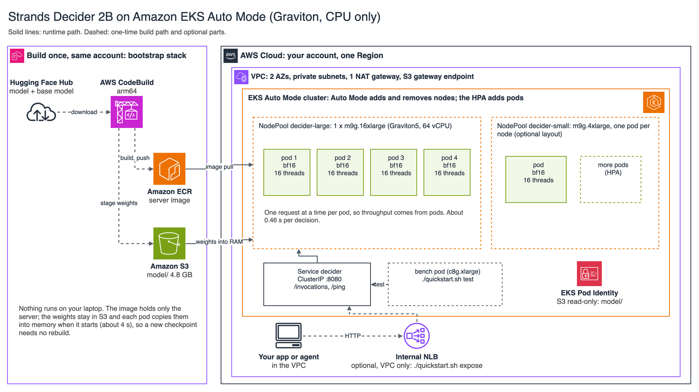
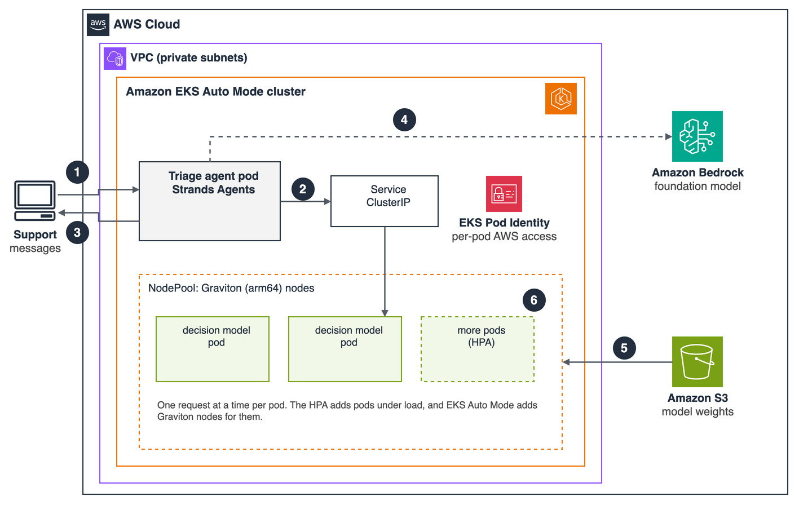

# Run decision models for AI agents on Amazon EKS Auto Mode

This sample runs the open source [Strands Decider](https://github.com/strands-labs/strands-decider) decision
model on Amazon EKS Auto Mode in your own AWS account. It uses AWS Graviton nodes by default, with an optional
NVIDIA GPU pool, and comes with a small triage agent built with Strands Agents that hands its low-confidence
answers to Amazon Bedrock. You fill in one config file, run one command, and it deploys and tests everything.
It accompanies the AWS Containers Blog post of the same name.

This is sample code, for non-production usage. You should work with your security and legal teams to meet your
organizational security, regulatory and compliance requirements before deployment.



## Why EKS, and what to expect
Agents make lots of small, bounded decisions: which team gets this message, is the request in scope, how urgent
is it. A decision model answers those in well under a second. Strands Decider is a 2B model built on
Qwen3.5-2B-Base, with a pointer head in place of the text-generation head, so instead of writing text that you
then have to parse, it gives you a probability for each option. Running it on EKS keeps it inside your VPC, next to
the rest of your Kubernetes workloads, and you scale it like any other service.

Here's what we measured with this quickstart (eu-west-1, 11 Nov 2026, strands-decider 0.3.0,
`strands-decider-2B-qwen3.5-v1-2610`, the routing-100 test set). Times are server-side, one request at a time
unless we say otherwise.

| | |
|---|---|
| Accuracy | 0.81 route accuracy, the same in bf16, in fp32 and on the GPU |
| Latency, CPU | **about 0.47 s per decision** with 4 pods x 16 threads on one m9g.16xlarge (2 questions, about 250 input tokens, bf16), and 0.65 s on one m9g.4xlarge |
| Latency, GPU (optional) | **about 0.16 s** on one NVIDIA A10G (g5.xlarge) |
| Throughput | about 5.1 decisions per second per m9g.16xlarge (16 in flight), 1.55 per m9g.4xlarge, 6.3 per g5.xlarge |
| Cost (estimate) | about **$0.18 to $0.21 per 1,000 decisions** on a busy Graviton node and **$0.05** on a busy g5.xlarge (list price plus the Auto Mode fee) |
| Cold start | **about 44 s** from zero nodes to the first answer on Graviton, about 3.3 min on a GPU node |
| Autoscaling | 1 to 4 pods (and nodes) in about 4.7 minutes under load, with no failed requests (1,600 of 1,600) |
| Resilience | no failed requests through two rolling restarts (1,200 of 1,200, through the internal NLB) or with both nodes replaced at once (480 of 480); measured on 20 Oct 2026 with strands-decider 0.2.0 |

Latency percentiles, in ms, over 100 requests sent one at a time:

| Variant | Node | p50 | p90 | p95 | p99 |
|---|---|---|---|---|---|
| `small-1x16-bf16` (default) | m9g.4xlarge | 648 | 662 | 665 | 677 |
| `large-4x16-bf16` | m9g.16xlarge | 472 | 514 | 527 | 551 |
| `gpu-1x2-bf16` | g5.xlarge (A10G) | 156 | 158 | 179 | 272 |

## What gets created
1. **A bootstrap stack** (CloudFormation, `<NAME>-bootstrap`). It holds a customer managed KMS key; a private,
   versioned S3 bucket for the model and the build source, encrypted with that key, with access logs going to a
   second bucket; an ECR repository with immutable tags, also encrypted with the key; and an arm64 CodeBuild
   project whose logs the key encrypts. The optional GPU image is built in the same project, on x86_64.
   CodeBuild downloads the model from the Hugging Face Hub into S3 and builds the image, so nothing large ever
   touches your laptop.
2. **An EKS Auto Mode cluster** (`<NAME>-eks`, created with eksctl) in its own VPC: 2 AZs, private subnets, one NAT
   gateway and a free S3 gateway endpoint. It also gets metrics-server and an EKS Pod Identity role that can only
   read the model prefix (and decrypt it through S3). The Kubernetes API is open only to the CIDRs you set.
3. **NodePools.** `decider-large` (several pods share one big node) and `decider-small` (one pod per node) run the
   model, and `decider-bench` runs the test client. If you set `INSTANCE_GPU`, you also get `decider-gpu`, with one
   NVIDIA GPU per pod; Auto Mode looks after the driver and the device plugin. All of them are tainted and capped,
   and empty nodes go away after 2 minutes.
4. **The Decider**: a Deployment, a PodDisruptionBudget and a ClusterIP Service in the `decider` namespace. Each
   pod copies the weights from S3 into memory when it starts (about 4 s for 4.8 GB; GPU pods copy them to the
   node's disk instead) and serves on port 8080. A `bench` pod runs the tests. If you want callers elsewhere in the
   VPC, you can add an **internal Network Load Balancer**.

## Security
- **Pods** run as non-root (uid 10001) with a read-only root filesystem (writable `emptyDir` volumes for the model
  and `/tmp`), no privilege escalation, all Linux capabilities dropped, seccomp `RuntimeDefault`, and no Kubernetes
  API token. EKS Pod Identity mounts its own token for AWS access. Images are pulled by digest.
- **Model weights** come over HTTPS from the Hugging Face Hub, pinned to fixed commits (`MODEL_REVISION` and
  `BASE_MODEL_REVISION` in `config.example.env`), and land in your own S3 bucket. They aren't in this repository.
- **AWS access** is scoped per pod with EKS Pod Identity. The decision model can only read the model prefix in S3
  and use the sample's KMS key to decrypt through S3. The agent can only invoke `ESCALATION_MODEL_ID` in Amazon
  Bedrock.
- **Network.** The server has no authentication of its own. The decision model sits behind a ClusterIP Service,
  and the optional NLB is internal and only accepts connections from `NLB_CIDRS` (the VPC by default). The
  Kubernetes API is open only to `API_CIDRS`.
- **Network policies aren't included.** We tested Kubernetes NetworkPolicies with the EKS Auto Mode network policy
  controller in October and again on 11 Nov 2026, with the decision model on m9g nodes. The policies were enforced,
  but a pod that started after the policy (a restarted agent, for example) couldn't reach a decision model pod that
  was already running, even though the policy listed the new pod, until that pod restarted. The network policy
  agent didn't retry a failed eBPF map update. The fixes are merged upstream
  ([aws-network-policy-agent#710](https://github.com/aws/aws-network-policy-agent/pull/710),
  [aws-ebpf-sdk-go#176](https://github.com/aws/aws-ebpf-sdk-go/pull/176)). Until an EKS Auto Mode node release
  picks them up, test that case in your own cluster before you add policies.
- **Scans.** semgrep, bandit, checkov (CloudFormation, Dockerfile and the rendered Kubernetes manifests, GPU ones
  included), cfn_nag, cfn-guard (Well-Architected security rules), shellcheck, git-secrets, detect-secrets and
  Trivy report no findings, and pip-audit finds no known vulnerabilities in the Python packages of either image
  (17 Nov 2026). Every suppression has its reason next to it: `ecr:GetAuthorizationToken` needs `Resource: "*"`;
  the access-log bucket doesn't log to itself; the bucket policies deny non-TLS requests per bucket rather than
  with `Resource: "*"`; the build role's policy is inline; the decision model has no CPU limit and no liveness
  probe by design; the bench pod has no probes; and there are no NetworkPolicies (see above).

## Prerequisites
- AWS CLI, eksctl 0.231 or later, kubectl 1.35 or later, Python 3.11+ (standard library only), `zip` and `curl`.
- Credentials that can create CloudFormation, IAM, S3, ECR, CodeBuild, EKS, EC2 and VPC resources.
- A Region with the Graviton instance types you pick (`./quickstart.sh preflight` checks this). For the optional GPU
  variant you also need `INSTANCE_GPU` in that Region, and a "Running On-Demand G and VT instances" quota of at
  least the vCPUs of `INSTANCE_GPU` times `MAX_NODES` (16 for 4 x g5.xlarge).
- `API_CIDRS=auto` lets in only the public IP you have when `cluster` runs. If your outbound IP changes later (VPNs
  and corporate networks often rotate it), kubectl and eksctl start timing out. In that case set `API_CIDRS` to your
  network's range, or add the new address with
  `aws eks update-cluster-config --name <NAME>-eks --resources-vpc-config publicAccessCidrs=<old>/32,<new>/32`.

This code interacts with the Hugging Face Hub, which has terms published at https://huggingface.co/terms-of-service
and pricing described at https://huggingface.co/pricing. You should be familiar with the pricing and confirm that
your use case complies with the terms before proceeding. The models it downloads are listed, with their licenses, in
[THIRD-PARTY-LICENSES](THIRD-PARTY-LICENSES).

If CodeBuild can't reach the Hugging Face Hub, run the steps one at a time and stage the weights yourself. After
`bootstrap`, on a machine that can reach the Hub (or with `HF_ENDPOINT` pointing at an approved mirror):
```bash
pip install 'huggingface_hub>=0.30'
set -a; . ./config.env; set +a       # MODEL_ID, BASE_MODEL_ID and both revisions
python3 app/stage_model.py /tmp/model "$MODEL_ID" "$BASE_MODEL_ID"
aws s3 sync /tmp/model/ s3://<bucket>/model/ --delete   # <bucket> is the bootstrap stack's BucketName output
```
Then carry on with `image`, `cluster`, `deploy` and `test`, and skip `weights`.

## Deploy
```bash
git clone https://github.com/aws-samples/sample-decision-models-on-amazon-eks.git && cd sample-decision-models-on-amazon-eks
cp config.example.env config.env      # set NAME, REGION, PROFILE, API_CIDRS; optionally the model and instances
./quickstart.sh up                    # about 20-25 min: preflight, bootstrap, weights, image, cluster, deploy, test
```
`up` runs these steps in order, and you can run any of them on its own:

| Step | What it does | Time |
|---|---|---|
| `preflight` | Checks tools, credentials, and that the instance types exist in your Region | seconds |
| `bootstrap` | Creates the bootstrap stack (bucket, ECR, CodeBuild) | about 1 min |
| `weights` | CodeBuild copies the model and its base model from the Hugging Face Hub to `s3://<bucket>/model/` | about 1-2 min |
| `image` | CodeBuild builds the arm64 image and pushes it to ECR (`image gpu` builds the optional x86_64 GPU image, about 6 min) | about 2 min |
| `cluster` | EKS Auto Mode cluster and the S3 gateway endpoint | about 12-15 min |
| `deploy` | NodePools, the Decider (`VARIANT`, or `deploy <variant>`) and the bench pod; waits until they're ready | about 1-2 min |
| `test` | routing-100 accuracy and latency, then a concurrency sweep, all from inside the cluster | about 2 min |

## Call it
From inside the cluster, use `http://decider.decider:8080/invocations` (or `/v1/systemone`; the health check is
`/ping`). For other callers in the VPC, run `./quickstart.sh expose`. It creates an internal NLB that only accepts
connections from the VPC's address range and prints its URL. Run 2 or more pods behind it. Then:
```bash
python examples/client.py http://<nlb-dns-name>
# or, from a laptop with kubectl access:
kubectl -n decider port-forward svc/decider 8080:8080 & python examples/client.py http://127.0.0.1:8080
```
The request uses the strands-decider "System One" shape: a `state` (the text you want a decision about) and named
`questions` of type `noul` (yes/no probability), `choice` (pick one option) or `score` (an ordinal scale). One
request can ask several questions; `examples/client.py` shows how. **The service has no authentication of its
own.** Keep it internal, and put auth in front of it (an API gateway or a service mesh) before you expose it wider.

## Use it from an agent


`examples/agent/triage.py` is a small triage agent built with [Strands Agents](https://strandsagents.com). For each
support message it asks the decision model, in one request, which team should get it and whether it's in scope. If
the route's confidence is at least `CONFIDENCE_THRESHOLD`, the agent uses that answer. If it's lower, or the
message is too long for the decision model, a Strands agent on Amazon Bedrock (`ESCALATION_MODEL_ID`, Amazon Nova 2
Lite by default) picks the team instead. EKS Pod Identity lets the agent pod invoke only that model.
```bash
./quickstart.sh agent                          # deploy it (ClusterIP Service "agent")
kubectl -n decider port-forward svc/agent 8081:8080      # in a second terminal
curl -s localhost:8081/triage -H 'content-type: application/json' -d '{"message": "I was charged twice this month"}'
./quickstart.sh threshold [labeled.jsonl]     # choose the threshold from your own labeled messages
```
`threshold` scores every labeled message once (one `{"text": ..., "route": ...}` per line, the routing-100 set by
default). For each candidate threshold it prints how many messages the decision model would answer on its own,
and how many of those it gets right.

## Operate
```bash
eval "$(./quickstart.sh env)"         # point kubectl at the cluster (in each new terminal)
./quickstart.sh status                # what's running
./quickstart.sh scale 0               # scale to zero; idle nodes go after about 3 minutes
./quickstart.sh scale 4               # back up again (cold start about 44 s)
./quickstart.sh autoscale             # CPU-based HPA (50%), 1-4 pods; Auto Mode adds the nodes (CPU variants)
./quickstart.sh deploy                # re-deploy after changing VARIANT or the model
./quickstart.sh deploy gpu-1x2-bf16   # the GPU variant (after ./quickstart.sh image gpu); plain deploy goes back to VARIANT
./quickstart.sh down                  # delete the cluster
./quickstart.sh down all              # ...and the bootstrap stack and its bucket
```
- **New checkpoint.** Change `MODEL_ID`, `MODEL_REVISION` (the new model's commit hash) and, if needed,
  `DECIDER_VERSION`. Then run `./quickstart.sh weights` followed by `kubectl -n decider rollout restart
  deploy/decider`. You only need to rebuild the image if you change `DECIDER_VERSION` (rebuild both images if you
  use the GPU variant).
- **Scaling faster.** Under load, the CPU-based HPA adds roughly one pod a minute. To react sooner you could set
  `minReplicas` above 1, keep a spare node warm with a low-priority placeholder pod, or scale on request rate or
  queue depth (KEDA, for example) instead of CPU. We haven't tested these. Routers built for LLM serving, such as
  llm-d, are designed around token-by-token generation; this model answers in one forward pass, one request per pod.
- **Logs.** `kubectl -n decider logs deploy/decider`. Every response includes `server_ms`, `compute_ms`,
  `queue_ms` and the name of the pod that answered (`host`).
- **Metrics.** For dashboards, add the Amazon CloudWatch Observability EKS add-on (Container Insights). It isn't
  part of the quickstart.

## Choosing a layout (`VARIANT`: `<pool>-<pods>x<threads>-<dtype>`)
| Goal | Variant | Measured (11 Nov) |
| --- | --- | --- |
| Lowest cost on CPU, small scaling steps | `small-1x16-bf16` (default) with `autoscale` | 648 ms; 1.55 req/s per m9g.4xlarge (about $0.18 per 1,000) |
| Lowest latency on CPU | `large-4x16-bf16` | 472 ms; 5.1 req/s per m9g.16xlarge with 16 in flight (about $0.21 per 1,000) |
| Lowest latency overall | `gpu-1x2-bf16` (set `INSTANCE_GPU`) | 156 ms; 6.3 req/s per g5.xlarge (about $0.05 per 1,000) |
| No gain on this model | `large-8x8-bf16` | 773 ms; 5.2 req/s per node, so no more throughput than 4x16 (21 Oct, 0.2.0) |
| Avoid | `*-fp32` on CPU (about 1.8x slower: 1.18 s on m9g.4xlarge), and `large-1x64-*` (slower for short prompts: 853 vs 453 ms on an earlier checkpoint, 12 Oct) | |

The cost per 1,000 decisions is an estimate. It's the node's hourly list price (EC2 plus the EKS Auto Mode fee)
divided by the decisions it answers in an hour while it's busy, so a node that's busy half the time costs twice as
much per decision. It doesn't include the control plane, the NAT gateway, the system nodes or any Amazon Bedrock
escalations. To bring it down, scale to zero when you're idle, use `autoscale` on the small pool, buy Savings Plans,
or try Spot capacity in the NodePools (we haven't tested Spot interruptions with this sample).

## CPU or GPU
We default to CPU. A decision is a single forward pass over a short prompt, with no token-by-token generation, so a
Graviton node answers in about half a second, there's no GPU quota or capacity to chase, and it scales in small
steps. Reach for the GPU pool when you need lower latency or more throughput per node. One A10G answered in 156 ms
and handled 6.3 decisions per second, which also makes it the cheaper option per decision while it's busy. The
catch is a longer cold start, about 3.3 minutes: the image is bigger, and Triton compiles its kernels when the pod
starts. In one of our two runs the first g5 launch also failed for lack of capacity, and Auto Mode retried in
another Availability Zone. To try it, set `INSTANCE_GPU` in `config.env`, then:
```bash
./quickstart.sh image gpu             # the x86_64 GPU image (about 6 min)
./quickstart.sh deploy gpu-1x2-bf16   # one GPU per pod on the decider-gpu NodePool
```

## What we learned
1. **Serve bf16 on Graviton5.** It's about 1.8x faster than fp32 with the same accuracy (648 vs 1,182 ms, 0.81
   both, 11 Nov; on 25 Oct it picked the same route for 100 of 100 messages). The package's own server runs fp32 on
   CPU. On Graviton3 and Graviton4 we saw the opposite, so check again if you change instance generation (`*-fp32`).
2. **Use around 16 threads per pod for short prompts.** 64 threads was slower (853 vs 453 ms). Long prompts (about
   2,000 tokens) do benefit from more threads.
3. **Stage the weights in RAM.** On the node's disk, 4 pods copying 4.7 GB each took 67 to 83 s (12 Oct). In RAM
   (`emptyDir` with `medium: Memory`, the default here), 4.8 GB takes about 4 s. Cold start from zero nodes is about
   44 s on Graviton (11 Nov): roughly 20 s for the node, 10 s for the image, then 10 s for the weights, the model
   and the warm-up.
4. **Send one request at a time to each pod**, and get throughput from more pods. Overlapping requests fight for the
   same cores. With the stock server, which doesn't serialise requests on CPU, one pod dropped from 0.83 to 0.24
   requests per second with 8 in flight (20 Oct, fp32, m9g.4xlarge). `app.py` takes a lock, so its throughput stays
   flat. Keep the number of requests in flight close to the number of pods, or put a queue in front, because the
   Service spreads connections randomly. The GPU pod behaves the same way: 6.3 requests per second at 1 to 8 in
   flight.
5. **Set a CPU request but no CPU limit**, so the CFS quota never throttles torch's threads. Do set a memory limit.
6. **arm64 needs its own NodePool.** EKS Auto Mode's built-in general-purpose pool is amd64 only.
7. **Drain before stopping.** Without a `preStop` sleep, requests sent through the NLB to a stopping pod waited up to
   138 s on TCP retries, and a rolling update caused a second of refused connections (20 Oct). A 30 s `preStop`
   sleep, NLB cross-zone load balancing and a 30 s deregistration delay fixed both (1,200 of 1,200 requests OK
   through the NLB across two rolling restarts).
8. **Add a PodDisruptionBudget** (`maxUnavailable: 1`) so one pod keeps serving while Auto Mode replaces nodes. With
   2 pods, deleting both nodes at once lost no requests (480 of 480 OK).
9. **Probe the port, not `/ping`.** `/ping` shares the server's thread pool with requests waiting for the lock, so a
   liveness probe on it can restart a pod just because it's busy.

## Other models
This quickstart serves the 2B Qwen3.5 Strands Decider checkpoints (set `DECIDER_VERSION` to the package version a
checkpoint was trained with). The Gemma 4 checkpoints are bigger: they need a larger `sizeLimit` and more memory in
`render.py`, plus their own `BASE_MODEL_ID`. Other small decision or classification models can reuse the same
cluster pattern (NodePools, weights in S3 staged into RAM, one process per pod, a bench pod), but they need their own
server in `app/`.

## Files
| File | What |
|---|---|
| `config.example.env` | Every setting |
| `quickstart.sh` | Every step |
| `bootstrap.yaml` | Bucket, ECR, CodeBuild (CloudFormation) |
| `buildspec.yml` | CodeBuild jobs: `weights` (Hub to S3) and `image` |
| `Dockerfile`, `app/` | The server (`app.py`: `/v1/systemone`, `/invocations`, `/ping`) and model staging (`stage_model.py`) |
| `examples/agent/` | The triage agent (`triage.py`, Strands Agents and Amazon Bedrock) and the threshold tool (`threshold.py`) |
| `cluster.yaml.tpl`, `render.py`, `k8s/` | eksctl config (including Pod Identity), NodePools (Graviton, and the optional GPU pool), Deployment, PodDisruptionBudget, Service, NLB, HPA, bench pod, agent |
| `examples/client.py` | Calling the Decider from your own code |
| `bench/` | The test client (`load.py`) and the routing-100 set |
| `docs/` | Architecture diagrams (PNG, plus `.drawio` files to edit them) |
| `LICENSE`, `THIRD-PARTY-LICENSES` | MIT-0 for this sample, and the licenses of the software and models it downloads |

## Cost
In eu-west-1 (list prices, Nov 2026), an m9g.16xlarge is $3.49/h plus the EKS Auto Mode fee of $0.42/h, an
m9g.4xlarge is $0.87 plus $0.105/h, and the optional g5.xlarge is $1.12 plus $0.088/h. While the cluster exists, add
about $0.23 to $0.31/h for the control plane, the NAT gateway and one or two small system nodes, and $0.19/h for the
bench node (c8g.xlarge) while the bench pod runs. The bootstrap stack's KMS key costs $1 a month while it exists,
plus KMS requests (the S3 Bucket Key keeps those low). Scale to zero when you're idle, and run `down` when you're
done. `down all` empties both buckets (every version) and deletes the stack, which schedules the KMS key for
deletion after 7 days.

## Reporting a security issue
See [CONTRIBUTING](CONTRIBUTING.md#security-issue-notifications) for more information.

## License
This sample is licensed under the MIT-0 License. See the [LICENSE](LICENSE) file. The software and models that the
sample downloads or installs are listed, with their licenses, in [THIRD-PARTY-LICENSES](THIRD-PARTY-LICENSES).
